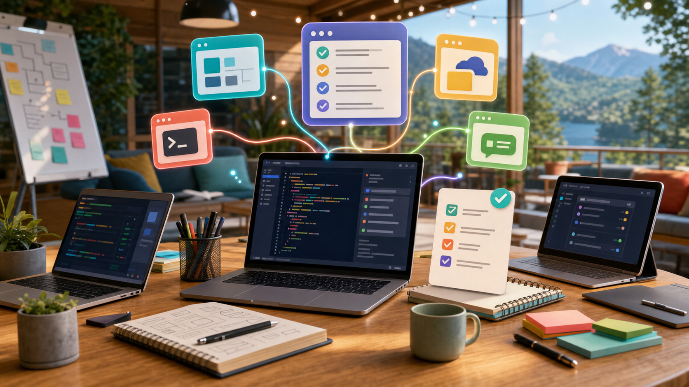

# Lit Ship AI Bootstrap

<p align="center">
  
</p>

<p align="center">
  <strong>Lit Ship AI合宿の当日セットアップを、Claude Code / Codex に任せやすくするための準備リポジトリです。</strong>
</p>

<p align="center">
  GitHub CLI / Google Workspace CLI / Lark CLI / AI開発ルール / プロジェクトテンプレートをまとめて整えます。
</p>

---

## 何をするリポジトリ？

合宿当日に参加者がつまずきやすい初期設定を、できるだけAIに進めてもらえる形にまとめています。

- 必要なCLIを入れる
- Claude Code / Codex の共通ルールを配置する
- 新規プロジェクト用の `CLAUDE.md` / `DESIGN.md` / `.claude/` を作る
- Larkを業務データの入口として扱うためのテンプレートを用意する
- 認証やログインが必要なところは、人間が判断できるように止める

## セットアップされるもの

| 種類 | 内容 | 目的 |
| --- | --- | --- |
| CLI | GitHub CLI (`gh`) | リポジトリ作成、PR、Issue、認証確認 |
| CLI | Google Workspace CLI (`gws`) | Drive / Gmail / Sheets などの操作準備 |
| CLI | Lark CLI (`lark-cli`) | Lark Base / Docs / Messenger 連携の準備 |
| Claude Code | `~/.claude/CLAUDE.md` | Claude Code に共通ルールを渡す |
| Codex | `~/.codex/AGENTS.md` | Codex に共通ルールを渡す |
| Project Template | `CLAUDE.md`, `DESIGN.md`, `.claude/rules` | アプリ制作を始める前の土台 |
| Lark Harness | `templates/lark-harness/` | 会社ごとのLark差分を安全に扱う |

## Quick Start

### Windows PowerShell

```powershell
.\scripts\setup.ps1
.\scripts\verify.ps1
```

### macOS / Linux

```bash
bash scripts/setup.sh
bash scripts/verify.sh
```

## 新しいアプリにテンプレートを入れる

作りたいアプリのフォルダを先に作ってから、以下を実行します。

### Windows PowerShell

```powershell
.\scripts\init-project.ps1 -TargetPath C:\path\to\your-app
```

### macOS / Linux

```bash
bash scripts/init-project.sh /path/to/your-app
```

実行後、対象フォルダに次のファイルが入ります。

```text
your-app/
├─ CLAUDE.md
├─ DESIGN.md
└─ .claude/
   ├─ agents/
   ├─ hooks/
   └─ rules/
```

## 認証でやること

CLIのインストール後、ログインや認証は本人のブラウザ操作が必要です。

```bash
gh auth login
gws auth setup
gws auth login -s drive,gmail,sheets
lark-cli config init
lark-cli auth login --recommend
```

Google Workspace CLI は、環境によって `gws auth setup` の途中でブラウザ確認が入ります。画面に出る案内に従って進めてください。

## Claude Code Setup の使いどころ

[Claude Code Setup](https://claude.com/plugins/claude-code-setup) は、コードベースを読んで MCP servers / Skills / Hooks / Subagents / Slash commands を提案してくれるAnthropic公式プラグインです。

合宿では、最初から全部を入れずに、必要なものだけをあとから足す方針にします。

1. このリポジトリでCLIと共通ルールを入れる
2. 作りたいアプリのフォルダを作る
3. `scripts/init-project.*` でプロジェクトテンプレートを入れる
4. Claude Code Setup に次のように頼む

```text
recommend automations for this project

このプロジェクトを分析して、必要な MCP サーバー、Skills、Hooks、Subagents、Slash commands を提案してください。
初心者が合宿中に使う前提なので、追加する価値が高いものを最大3つに絞って、日本語で理由を説明してください。
```

## Lark Harness の考え方

Lark CLI は、単にLarkを操作するためだけではなく、AIが業務データを安全に使うための入口として扱います。

このリポジトリでは、Larkを次の3層で扱います。

| 層 | 役割 |
| --- | --- |
| Universal Checks | どの会社でも守る共通ルール |
| Tenant Overrides | 会社ごとの呼び方、締日、承認ルール |
| LLM Hybrid | ルールだけで判断できない部分をAIに相談する |

テンプレートは `templates/lark-harness/` にあります。最初はサンプルをコピーして、必要な項目だけ埋めます。

## AIに最初に頼む文

Claude Code / Codex にこのまま貼り付けて使えます。

```text
このリポジトリの README.md を読んで、Lit Ship AI合宿の当日セットアップを進めてください。
まず OS と入っているコマンドを確認し、必要な CLI をインストールし、Claude Code / Codex の共通ルールを配置してください。
認証や外部サービスへのログインが必要なところは、何をするか日本語で説明してから、私に操作を渡してください。
```

## フォルダ構成

```text
litship-ai-bootstrap/
├─ assets/
│  └─ readme-hero.png
├─ scripts/
│  ├─ setup.ps1
│  ├─ setup.sh
│  ├─ verify.ps1
│  ├─ verify.sh
│  ├─ init-project.ps1
│  └─ init-project.sh
├─ config/
│  ├─ claude/
│  │  └─ CLAUDE.md
│  └─ codex/
│     └─ AGENTS.md
├─ templates/
│  ├─ lark-harness/
│  └─ project/
├─ prompts/
│  └─ recommended-prompts.md
└─ docs/
   └─ optional-agentmemory.md
```

## 注意

- APIキー、パスワード、本番環境の認証情報は貼らないでください。
- 本番DBや本番Lark Baseには、合宿中のAIエージェントから直接触らせないでください。
- `Auto-approve` や危険な権限スキップ設定は使わないでください。
- エラーが出たら、まずエラー文をAIに貼って「これ何？日本語で説明して」と聞いてください。
- それでも解決しない場合は、三宅に連絡してください。
